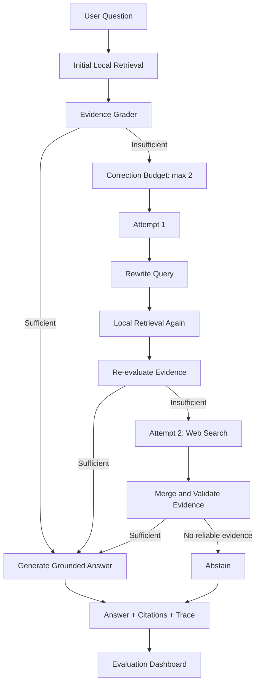

<div align="center">

# Budget-Constrained Self-Corrective RAG

### Failure-aware corrective retrieval with Groq-powered answers


</div>

This project answers questions using indexed documents and web sources. It
combines FAISS retrieval, local `sentence-transformers/all-MiniLM-L6-v2`
embeddings, and a Groq chat model in a
**Budget-Constrained Self-Corrective RAG pipeline with Failure-Aware Routing**.
All question answering uses the CRAG pipeline.

## Features

- **Groq chat model:** configured with `GROQ_API_KEY`; defaults to
  `qwen/qwen3.8-27b`.
- **Local embeddings:** `sentence-transformers/all-MiniLM-L6-v2` runs on your
  machine through `HuggingFaceEmbeddings`. Embedding requests do not use an
  OpenAI API key or a hosted embedding API.
- **FAISS retrieval:** creates an in-memory vector index from processed
  document chunks.
- **One strict retrieval path:** every question is graded, locally retried once
  with a rewritten query, then sent to Wikipedia as the final correction if
  needed.
- **Evidence-safe responses:** generate with citations only when merged
  evidence is sufficient; otherwise abstain.
- **Two ways to run:** a Streamlit interface or the command-line application.

Groq chat completions and source downloads require an internet connection. On
first start, Hugging Face downloads the embedding model, which is then run
locally.

## Requirements

- Python 3.13 or newer
- [uv](https://docs.astral.sh/uv/) (recommended), or Python's `venv` and `pip`
- A Groq API key
- Internet access for Groq, configured web sources, Wikipedia, and the initial
  embedding-model download

## Getting started

### 1. Clone the repository and install dependencies

Clone the project and enter its directory:

```powershell
git clone https://github.com/proindra/prompt_mini_project.git
cd prompt_mini_project
```

Install the locked dependencies:

```powershell
uv sync
```

`uv sync` creates `.venv` and installs the dependencies from `uv.lock`.

### 2. Configure Groq

Create your local environment file from the example:

```powershell
Copy-Item .env.example .env
```

Open `.env` and replace the placeholder with your Groq API key:

```env
GROQ_API_KEY=your_groq_api_key
GROQ_MODEL=qwen/qwen3.8-27b
USER_AGENT=BudgetCRAG/0.1 (contact: you@example.com)
```

`GROQ_API_KEY` is required. `GROQ_MODEL` is optional; if omitted, the
application uses `qwen/qwen3.8-27b`. Set it to a model ID currently available
to your Groq account. `USER_AGENT` identifies requests made to web sources;
the application supplies `BudgetCRAG/0.1` if it is omitted.

Keep `.env` private. It is excluded from Git; commit `.env.example`, not your
personal `.env` file.

### 3. Run the Streamlit app

```powershell
uv run streamlit run streamlit_app.py
```

Open the local URL printed by Streamlit (usually `http://localhost:8501`). The
first initialization may take longer while the embedding model is downloaded
and the document index is built. Submit a question; the app follows the strict
retrieval flow and shows its answer, evidence citations, and trace. Each result
then feeds the Evaluation Dashboard, which summarizes actual questions asked
during the current app session.

The **Run versioned dataset evaluation** expander runs
`data/evaluation_dataset.json` through the same strict pipeline. This makes
live Groq calls (and may make Wikipedia calls). It displays answer token F1
when a reference answer is supplied, LLM-judged answer support, evidence
sufficiency, expected-action accuracy, architecture route counts, retrieval
and web-call counts, correction use, latency, abstention, and correction
success. Results can be downloaded as JSON. No evaluation scores are
pre-filled or claimed in advance.

### Strict CRAG methodology

- Every question starts with local retrieval and an LLM evidence grade.
- If insufficient, attempt 1 rewrites the original question and retries local
  retrieval; evidence is graded again.
- If still insufficient, attempt 2 searches Wikipedia, merges external and
  local evidence, and grades the combined evidence.
- The initial retrieval is not counted as a correction. The per-question
  correction counter has a hard maximum of two.
- Sufficient evidence generates a grounded answer with citations. Insufficient
  or contradictory evidence, including web-search failure, produces abstention.
- Grading uses the configured Groq model and the evidence text; vector
  similarity is only used to retrieve candidate passages, not to decide
  whether evidence is factually sufficient.
- Dataset categories describe intended challenge cases, not guaranteed
  routing outcomes. Retrieval, model responses, and Wikipedia results can vary.
  The dashboard reports measured results rather than asserting improvements.
- Answer correctness is token-level F1 against the included reference answers.
  Evidence support is a separate LLM judgment of whether the answer is
  supported by its retrieved passages. The support-judge latency is reported
  separately from pipeline latency.
- `data/attention.pdf` is loaded alongside the configured URLs. The index is
  still in-memory and rebuilt on startup.

## Novelty and project contribution

The contribution is a **bounded, observable implementation** of self-corrective
retrieval, not a claim that CRAG or query rewriting is a newly invented
algorithm:

- **A fixed correction budget:** each question gets one rewritten local retry
  and, only if evidence is still insufficient, one web-search attempt.
- **Evidence-gated answers:** initial, rewritten, and merged evidence are
  graded; the system generates only when evidence is sufficient and otherwise
  abstains.
- **Failure-aware, inspectable routing:** each result exposes evidence grades,
  correction steps, sources, citations, and measured retrieval and latency
  metrics, including when web search fails.
- **Evaluation matched to the architecture:** the versioned dataset reports
  which route each question actually took, stage-level evidence sufficiency,
  expected-action accuracy where specified, answer support, and answer quality.

This makes the system's correction-versus-abstention behavior measurable. The
evaluation reports observed outcomes; without a baseline comparison, it does
not claim the approach outperforms other RAG systems.

### Run the command-line app instead

```powershell
uv run python main.py
```

The CLI initializes the same CRAG components, runs its example questions
through the strict pipeline, and offers an interactive prompt. Type `quit`,
`exit`, or `q` to leave interactive mode.

## System architecture



The Streamlit app and CLI both use the same strict CRAG pipeline and in-memory
FAISS index. Every displayed answer, evidence set, and trace feeds the
session-level Evaluation Dashboard. A separate versioned-dataset evaluation
is available in the app for reference-answer metrics.

### Research request flow

1. **Build the shared index.** `DocumentProcessor` loads the configured web
   pages and PDFs in `data/`, then splits text into chunks (500 characters
   with 50 characters of overlap by default). `VectorStore` embeds the chunks
   locally and builds the in-memory FAISS index.
2. **Grade initial evidence.** The configured Groq model evaluates whether the
   local passages are relevant, sufficient, or contradictory.
3. **Correct at most twice.** If initial evidence is insufficient, CRAG rewrites
   the query and retries local retrieval (attempt 1). If it remains
   insufficient, it searches Wikipedia (attempt 2). The initial retrieval is
   not counted as a correction, and the counter is per question.
4. **Validate and respond.** Local and external passages are merged and
   graded. Sufficient evidence produces a grounded answer with numbered
   citations; insufficient or contradictory evidence produces an abstention.
   The response includes sources, routing trace, and measured timing/count
   metrics.
5. **Evaluate the output.** Each answer, citation set, trace, and metric is
   added to the session-level Evaluation Dashboard. The versioned dataset
   evaluation is available separately and reports measured outcomes without
   fabricated or pre-filled results.

The CLI entry point is `main.py`. Streamlit setup and dashboards are in
`streamlit_app.py`. The strict retrieval flow, evidence grading, traces, and
evaluation metrics are implemented in `src/research/crag.py`; the Wikipedia
adapter is in `src/research/web_search.py`. Model configuration is in
`src/config/config.py`.

The FAISS index is rebuilt when the app initializes; it is not persisted between
process runs. Streamlit caches the CRAG pipeline and vector index for the
current app process.

## Sources and configuration

The default web pages are listed in `Config.DEFAULT_URLS` in
`src/config/config.py`. Adjust this list to index other web pages. PDF documents
placed in `data/` are also loaded by the document processor. After changing
sources, restart the app so its index is rebuilt.

Chunk sizing is controlled by `Config.CHUNK_SIZE` and `Config.CHUNK_OVERLAP`.
The embedding model is configured in `src/vectorstore/vectorstore.py`.

## Troubleshooting

- **Missing API key:** confirm `.env` exists beside `pyproject.toml` and has a
  non-empty `GROQ_API_KEY`.
- **Model not found or no access (Groq 404):** set `GROQ_MODEL` to an active
  model ID available to your Groq account, then restart Streamlit.
- **Slow first startup:** the embedding model must be downloaded once. Later
  starts use the local Hugging Face cache.
- **Source or Wikipedia request errors:** check your internet connection and
  try again. Wikipedia requests use the public English Wikipedia API.
- **Changed environment variables:** restart the Streamlit process after
  editing `.env`.

## Dependency management

After changing dependencies in `pyproject.toml`, refresh and install them with:

```powershell
uv lock
uv sync
```

`requirements.txt` is also provided for pip-based installations.
